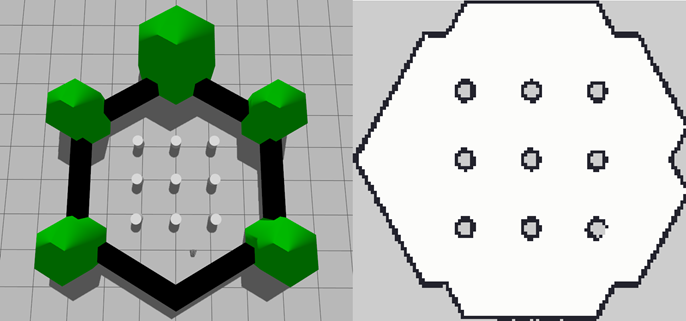
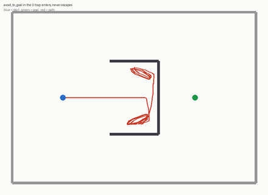
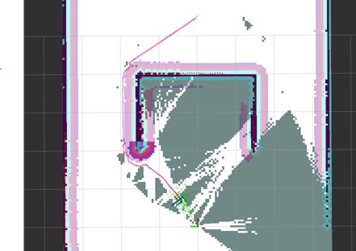
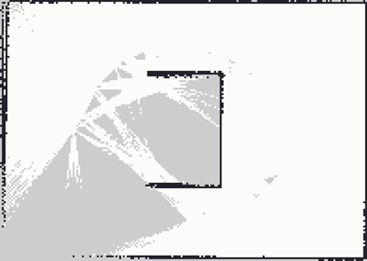
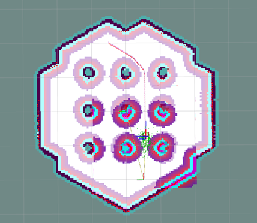

# Building a Mobile Robot Navigation Stack

A ROS 2 Jazzy / Gazebo Harmonic project that starts with a hand-written
proportional controller and uses Nav2 to solve problems that the controller cannot.



*`turtlebot3_world` and the map of the world built by driving the robot around it using 360 lidar rays at 5 cm resolution.*

## Project Progression

| Step | Additions |
|---|---|
| 1 | `scan_inspector` — read-only lidar diagnostics |
| 2 | `go_to_goal` — proportional control to (x, y) coordinates |
| 3 | `avoid_to_goal` — travels to goal with reactive avoidance |
| 4 | Nav2 with a prebuilt map for global planning |
| 5 | SLAM with `slam_toolbox` for building a map |
| 6 | `patrol` — a `NavigateToPose` action client |
| 7 | Costmap tuning |
| 8 | A U-trap world to test controller limits |

## Results

Step 8 builds a world specifically to separate reactive steering from
planning: a U-shaped trap with the goal behind its closed end.



*The path taken by the robot using node `avoid_to_goal`*

`avoid_to_goal` drives in and then circles inside the trap indefinitely. 
Escaping requires driving away from the goal for several meters, which no purely local rule produces.

Nav2, given the same start and goal, plans a 1.27× detour around the outside and
arrives at the goal.



*Nav2's global plan routing around the outside of the trap, with the costmap inflation shaded around the walls and the AMCL particle
cloud at the robot. Grey is space the robot has not yet seen.*



*The U-trap world mapped by SLAM. The trap's interior stays unknown because
the robot only ever drove around it.*



*The same stack in `turtlebot3_world`. Every pillar carries an inflation ring
from the costmap, and the plan threads the gaps between them. The clearance
that the rings leave is what the `inflation_radius` tuning in step 7 controls.*

## Debugging

**Smeared SLAM map and aborted navigation goals:**
`slam_toolbox` warned at startup that `max_laser_range` of 20.0 m exceeded the
lidar's 3.5 m reach. `inf` returns from scan were raytraced to 20 m and created 
phantom obstacles. The phantom obstacles reached Nav2 through the static costmap 
layer, causing all navigational goals to abort. Setting the range to 3.5 
resolved the issue.

**Navigation group aborted before accepting any goal:** With
`set_initial_pose: false`, nothing published the `map → odom` transform. The
global costmap timed out waiting for it and the lifecycle manager aborted the
whole navigation group, after which every goal was rejected with "Action
server is inactive". Publishing a pose afterwards did not recover it, and a
`ManageLifecycleNodes` RESET/STARTUP left `bt_navigator` marked active without
a live action server. Setting `set_initial_pose: true`, with the robot's
actual spawn pose rather than the origin, resolved the issue.

**`odom` and `map` are different frames:** A goal was given in the odom frame,
which is anchored wherever the robot booted rather than at the world origin,
placing it outside the arena wall. The reactive controller circled the inside
of the enclosure chasing an unreachable point, which was initially misread as
a local minimum. Goals were moved to the `map` frame, and the U-trap world was
built to demonstrate the local minimum properly.

**Costmap inflation tuned by measurement:** The default `inflation_radius` of
0.5 m added cost to every gap between pillars, since the gaps are narrower
than the radius. Path length was measured with the `compute_path_to_pose`
action, which plans without driving, while sweeping the radius on a live
stack: 4.44 m at 0.2, 4.70 m at 0.5 and 4.70 m at 1.0 on the same query.
Values above ~0.5 had no effect because every free cell was already inflated.
The radius was set to 0.3, shortening paths while keeping three times the
robot radius of clearance.

**Custom worlds need an enclosure:** The first U-trap world was open. With
nothing to reflect the lidar in most directions the SLAM map barely grew, and
Nav2 rejected goals as outside bounds. An enclosure was added to reflect lidar,
allowing SLAM to create a map.

## Package: `robot_lab`

| Node | Function |
|---|---|
| `scan_inspector` | Read-only lidar diagnostics: nearest return per sector. |
| `go_to_goal` | Drives to a point with no obstacle sensing. |
| `avoid_to_goal` | Drives to a point with reactive obstacle avoidance. |
| `patrol` | Sends a waypoint list to Nav2 via the NavigateToPose action. |

`robot_lab/geometry.py` holds the shared helpers: `normalize_angle`,
`yaw_from_quaternion`, `quaternion_from_yaw`, `clamp`, `sector_min`,
`corridor_min`.

`config/` holds tuned parameter files, `worlds/` the U-trap world, `maps/`
SLAM-built maps of both worlds.

## Run

TurtleBot3:

```bash
export TURTLEBOT3_MODEL=burger
ros2 launch turtlebot3_gazebo turtlebot3_world.launch.py    # or empty_world
ros2 run robot_lab scan_inspector
ros2 run robot_lab avoid_to_goal --ros-args -p goal_x:=2.0 -p goal_y:=0.0
```

Nav2 with a prebuilt map:

```bash
ros2 launch turtlebot3_navigation2 navigation2.launch.py use_sim_time:=True \
  params_file:=$HOME/gz_robot_ws/src/robot_lab/config/nav2_burger.yaml
ros2 run robot_lab patrol --ros-args -p use_sim_time:=true \
  -p waypoints:="[1.5, 0.0, 1.5, 1.5, -1.0, 1.0]"
```

SLAM, to build a new map:

```bash
ros2 launch slam_toolbox online_async_launch.py use_sim_time:=true \
  slam_params_file:=$HOME/gz_robot_ws/src/robot_lab/config/slam_burger.yaml
ros2 run teleop_twist_keyboard teleop_twist_keyboard --ros-args -p stamped:=true
ros2 run nav2_map_server map_saver_cli --ros-args -p use_sim_time:=true \
  -p save_map_timeout:=20.0 -f ~/gz_robot_ws/src/robot_lab/maps/my_map
```

The U-trap world:

```bash
ros2 launch robot_lab u_trap.launch.py
ros2 run robot_lab avoid_to_goal --ros-args -p use_sim_time:=true \
  -p goal_x:=5.5 -p goal_y:=0.0          # never arrives
ros2 launch turtlebot3_navigation2 navigation2.launch.py use_sim_time:=True \
  map:=$HOME/gz_robot_ws/src/robot_lab/maps/u_trap.yaml \
  params_file:=$HOME/gz_robot_ws/src/robot_lab/config/nav2_utrap.yaml
ros2 run robot_lab patrol --ros-args -p use_sim_time:=true -p waypoints:="[5.5, 0.0]"
```

## Environment

WSL2 + WSLg. `export GALLIUM_DRIVER=d3d12` is required in `~/.bashrc`. Verify
with `glxinfo -B | grep "OpenGL renderer"`, which should name the GPU rather
than `llvmpipe`.
